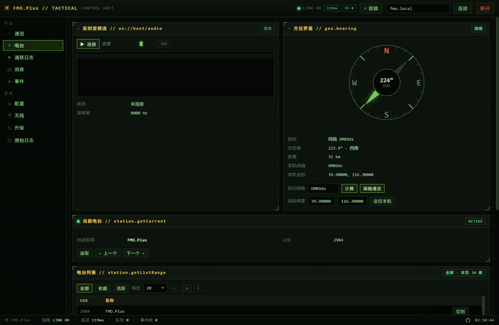

# FMO.Plus — 战术风 Web 控制台

仓库：<https://github.com/Hanice404/FMO.Plus>

一个单文件、零依赖的 Web 控制台，用于通过浏览器控制 **FMO**（业余无线电 APRS 台站控制器）。
界面是军绿 CRT 战术终端风格；所有功能都直接跑在设备自带的 WebSocket 控制面上，**不需要改固件、不需要在设备上安装任何东西**。

> 本项目为第三方非官方客户端，通过观察设备自带网页的通信行为复刻实现，不包含设备厂商的任何源码。

---

## 界面预览

**电台页**（内容区 ≥680px 自动两列：实时音频流 ｜ 方位罗盘，两卡等高且罗盘随高度放大；下方「当前电台」「电台列表」「导入原始报文」各占整行通栏）



---

## 特性

**连接**
- 直连 `ws://<设备>/ws`（请求-响应）与 `ws://<设备>/events`（只推不收）
- 全局串行请求队列 + 超时重试，适配设备"同一时刻只处理一条"的限制
- 断线自动重连（1s→8s 退避）；「断开」会彻底拆掉主通道 / 实时通道 / 音频流
- 默认地址 `fmo.local`（设备 mDNS 别名），也可填 IP

**9 个面板**

| 面板 | 内容 |
|---|---|
| 通信 | 身份（呼号/UID/角色/证书/MQTT）、屏幕模式、链路自检、实时通道状态 |
| 电台 | 实时音频（PCM 流播放 + 电平 + 频谱）、当前台站、**方位罗盘**、台站列表（全部/收藏/活跃，分页）、导入原始报文 |
| 通联日志 | 分页列表（**含方位/距离**）、详情（频率/网格/中继/寄语）、签名与公钥、备份 zip / 导出 ADIF |
| 消息 | 收件箱、详情自动已读、发送（含送达回执）、分页 |
| 事件 | 事件列表与正文、发布、清空、黑名单 |
| 配置 | 22 项寄存器结构化读写，逐项校验、写后回读、管理员项按角色显隐 |
| 无线 | 频谱扫描（两段式时序）、当前连接、接入/断开/忘记、手动保存 |
| 升级 | 通道查询、真实 OTA 进度、重启、系统重置 |
| 原始日志 | 收发报文实时流、按关键字过滤、导出 .log、手动下发任意请求 |

**方位 / 距离**

设备本身不提供任何方位字段，方位全在前端算：

- 本机坐标取自 `config/getCordinate`（WGS84）；对方位置来自 Maidenhead 网格（`qso.getList.toGrid`、`qso.getDetail.toGrid`、`/events` 的 `qso/callsign.grid`），也支持手填网格或经纬度
- 大圆方位角（真北 0°、顺时针）+ Haversine 距离；网格支持 4/6/8 位，经纬度 ⇄ 网格可互转
- 「跟随通话」默认开启且按钮直接显示**开/关**（`跟随通话 · 开` / `跟随通话 · 关`）：`qso/callsign` 推送一到，罗盘指针自动转向正在讲话的台站；手动填目标点「计算」会自动退出跟随
- **首次进入自动定位**：直接读设备坐标（失败重试 3 次，结果缓存 30 天），并预填本机网格/经纬度，不用点「定位本机」
- 通联台账每行直接由 `toGrid` 算出方位与距离（如 `BH1OPZ · OM78gb → 216° · 256 km`）
- 罗盘直径随卡片高度自适应放大（172 → 最大 320px ），手机 ≤620px 为 216px

**布局自适应**：内容区 ≥680px 时电台页分两列 —— 「实时音频流 ｜ 方位罗盘」并排且严格等高，「当前电台 / 电台列表 / 导入原始报文」各自整行通栏；窄于 680px 回到单列，与横竖屏无关。

**音频单按钮**：连接/停止合成一个按钮并显示状态 —— 未连接是绿色 `▶ 连接`，握手时琥珀 `⋯ 连接中`（禁用），接通后红色 `■ 停止 · LIVE`，顶栏开关与它状态同步。

**音频 KV 常显**：`状态 / 采样率 / 已收帧 / 累计时长 / 缓冲队列` 五行在未连接、连接中、接收中、已停止四种状态下都显示（未连接为 0），每次新建连接从 0 起算，停止后保留本次累计值。

**电平条**：时域 RMS(70%) + 峰值(30%) 再按 dB 映射（-54 dB → 0%、0 dBFS 才 100%），带快攻击/慢释放平滑，不会一有声就顶满。

**电台列表一次切换**：点行或「切到」一次即进入琥珀色「切换中」（期间禁点、自动重试最多 3 次），设备确认后变绿色「当前」；当前行整行高亮，三种状态按钮统一 64×26。设备 `getCurrent` 切换后可能短暂报旧值，用 3.5s 保护窗口屏蔽并自动重读校正。

**屏幕模式平铺**：`ui.getScreenMode` 用三个瓦片选择 —— `0 正常模式`、`1 睡眠模式`、`2 禅丶模式`，选中项高亮；「读取」刷新、「设置」下发。

**交互细节**
- 每页首次进入自动加载，按钮保留用于手动刷新
- 所有模块标题统一「中文 // 英文（接口/通道）」，如 `当前电台 // station.getCurrent`
- 导航小点：有新消息 / 升级进行中 / 有新公告时点亮，进页即灭
- 全站单行排版，超长值省略号 + 悬停看全文
- 危险操作需键入确认词（`REBOOT` / `RESET` / `UPGRADE` / `CLEAR` 等）

---

## 快速开始

```bash
# 方式一：直接双击 index.html（file:// 也能用）

# 方式二：起本地静态服务（推荐）
node serve.mjs 7788
# 然后打开 http://127.0.0.1:7788/
```

首次打开会自动连 `ws://fmo.local/ws`。连不上就点右上角地址栏改成设备 IP（如 `192.168.1.50`），回车即连；地址会记在 localStorage。

---

## 协议概要

请求与响应同构，`subType` 请求 → `subType + "Response"` 响应：

```jsonc
// 发
{ "type": "config", "subType": "getRole", "data": {} }
// 收
{ "type": "config", "subType": "getRoleResponse", "data": { "role": 2 }, "code": 0 }
```

- `type` 取值：`user` / `ui` / `config` / `wifi` / `qso` / `message` / `event` / `blocked` / `station` / `serverUsers`
- 失败通常体现在 `data.result !== 0`，`code` 只在少数类型里被校验
- `/events` 推送：`ota/progress`、`qso/progress`、`message/summary`、`message/ack`、`qso/callsign`、`qso/history`、`station/import`
- `/audio` 为 8 kHz / 16-bit LE / 单声道 PCM 裸流，**只在有音频活动时推流**

若干实测得出的设备行为（写在这里免得后来者踩坑）：

- `station/getListRange` 单次最多稳定返回 **20 条**，`count=24` 在部分偏移会返回空包，`≥25` 直接返回空
- `wifi/scanWifi` 只是 ack，必须再轮询 `wifi/scanWifiResult`（`code=-5/-1` 表示仍在扫描），一次扫描约 15–25 秒
- `config/set*` 写入后立刻 `get` 会读到旧值，存在缓存延迟
- 部分固件未实现 `blocked/getList`（请求无响应）

---

## 注意

- **GitHub Pages 无法直接连设备**：浏览器禁止 `https://` 页面发起 `ws://` 明文连接（混合内容）。页面可以部署上去做展示，但要真正控制设备，请在本地用 `file://` 或 `node serve.mjs` 打开；或者自建一个 `wss://` 反代。
- 设备侧**没有任何鉴权**，同一局域网内任何人都能连接并改配置。请只在可信网络中使用。
- 破坏性操作（升级 / 重启 / 恢复出厂 / WiFi 断连）请自行确认后果。

---

## 许可

[MIT](LICENSE) © 2026 Hanice404

本项目是**第三方非官方客户端**：通过观察设备自带网页的通信行为复刻实现，不包含设备厂商的任何源码，与设备厂商无隶属或授权关系。使用与分发风险自担；设备侧无鉴权，请仅在可信网络中使用。
